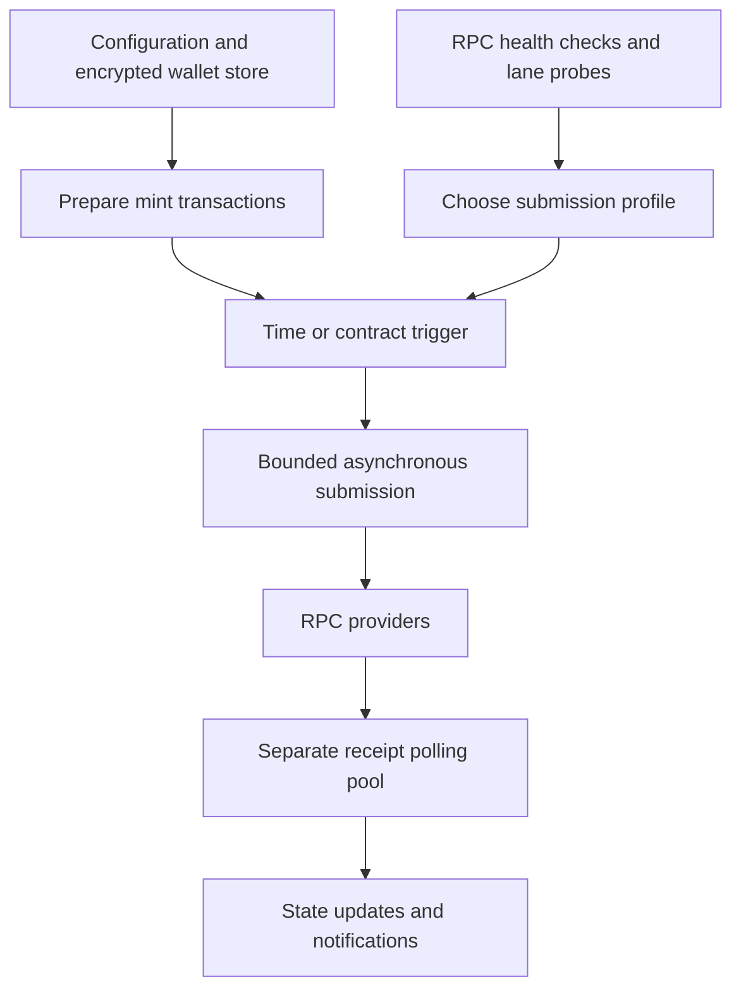

# Multi-Wallet NFT Minting System

**Python · asynchronous networking · blockchain transactions · performance testing**

I built a Python minting system designed to prepare and submit NFT mint transactions across multiple wallets with as little work as possible left for the launch moment. The implementation includes a Telegram control interface, scheduled triggers, encrypted wallet storage, RPC endpoint routing, receipt tracking and optional OpenSea workflows.

## What I focused on

The main challenge was handling a burst of transaction submissions without letting connection limits, slow providers or receipt polling interfere with the critical path.

Before a launch, the system can prepare calldata and signed transactions, warm HTTP connections and measure candidate RPC lanes. At the trigger, the submission path sends the prepared transactions while concurrency controls keep the workload bounded. Receipt polling uses its own HTTP session and connection pool.

## Major components

| Component | Responsibility |
| --- | --- |
| `mintbot/rpc.py` | RPC calls, latency probes, adaptive lane selection, submission and receipt pools |
| `mintbot/runner.py` | Transaction construction, signing and mint attempts |
| `mintbot/trigger.py` | Scheduled and polled launch conditions |
| `mintbot/walletstore.py` | Encrypted wallet storage and selection |
| `telegram_bot.py` | Commands, prewarm flows, scheduling and status notifications |
| `mintbot/opensea_api.py` and related modules | Marketplace integration and state tracking |
| `tests/` | Local synthetic pressure, regression and failure-case tests |

## Engineering decisions

### Separate receipt polling from transaction submission

Receipt requests used to compete with outgoing transactions for the same HTTP connector. The revised implementation gives receipt polling its own `aiohttp` session, connector and bounded capacity. In the supplied controlled 500-wallet synthetic workload, the report lists submission p95 falling from **511.0 ms to 341.0 ms**. All 500 synthetic submissions were observed in both runs.

### Measure routing conditions shortly before the launch

A provider that responded quickly at process startup might not still be the best endpoint hours later. The scheduling code refreshes endpoint health during prewarm and probes candidate concurrent lane widths using harmless RPC reads. The results guide the launch profile used by the submission system.

### Keep the trigger path narrow

The system prepares calldata and signs the first submission attempt before the trigger. It also warms connections and chooses a submission profile in advance, avoiding unnecessary work when the trigger fires.

### Bound the pressure on external services

Submission, endpoint selection and receipt polling have explicit concurrency limits. The tests include provider fallback, wallet-count restrictions and receipt load scenarios. The supplied report notes that a larger submission cap was tested but not made the default because the improvement was inconsistent.

## What the supplied tests show

The reports describe local/synthetic checks for burst scheduling, provider failure, receipt pressure, trigger timing, supply restrictions and simulated first-come-first-served competition. One reported 500-wallet synthetic transport comparison was:

| Submission metric | Shared connector | Isolated receipt connector |
| --- | ---: | ---: |
| p50 | 400.2 ms | 231.7 ms |
| p95 | 511.0 ms | 341.0 ms |
| Maximum | 539.2 ms | 370.6 ms |

The figures come from the project’s reported synthetic transport tests, rather than live-chain execution measurements.
